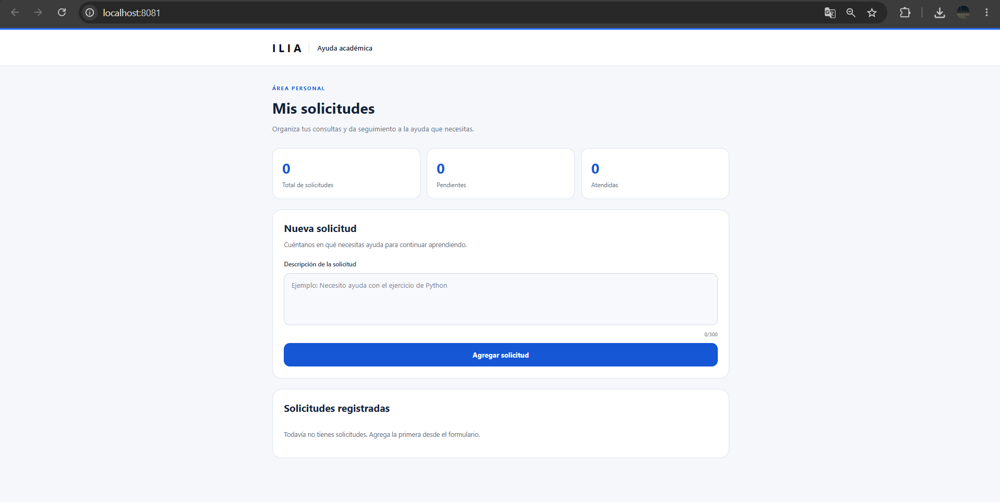
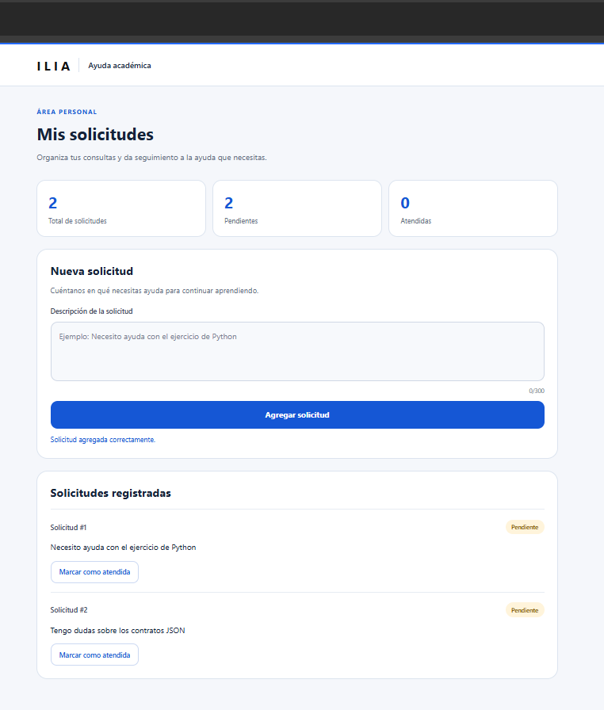
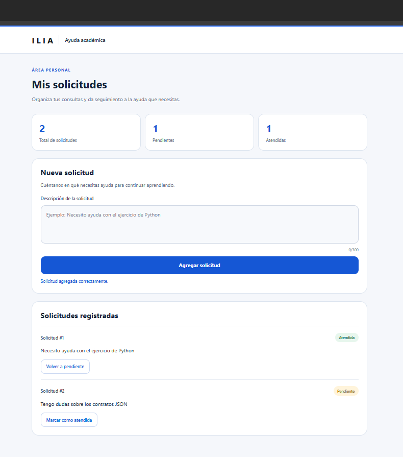

# Práctica 3.3 · Orquestación y composición de capacidades

## Demostración: gestión de estado compartido

Aplicación desarrollada con React Native y Expo, con una interfaz inspirada en la plataforma ILIA, que permite registrar solicitudes de ayuda académica, consultar sus estados y marcarlas como atendidas.

El formulario, la lista y el resumen comparten la misma información mediante React Context, y los cambios aparecen inmediatamente sin recargar la pantalla.

## Integrantes del proyecto integrador

- Víctor Hugo Zambrano Martínez (Autor de la práctica)
- Luis Figueroa Arteaga
- Bryan Menoscal
- Carlos Chile Silva

## Requisitos

- Node.js LTS y npm.
- Navegador web.
- Terminal PowerShell o equivalente.

## Cómo ejecutar

Desde la raíz del repositorio:

```powershell
cd practica-3-3-orquestacion
npm ci
npx expo start --web --port 8081
```

Abre http://localhost:8081 y deja la terminal en ejecución.

Para detener la aplicación, presiona `Ctrl + C`. En las siguientes ejecuciones basta con entrar en la carpeta e iniciar Expo; repite `npm ci` cuando cambien las dependencias.

## Organización del código

| Archivo | Responsabilidad |
|---|---|
| `App.js` | Compone la pantalla y envuelve los componentes con el provider. |
| `context/SolicitudesContext.jsx` | Mantiene la lista compartida y permite agregar solicitudes y cambiar su estado. |
| `components/FormularioSolicitud.jsx` | Captura la descripción y registra una solicitud pendiente. |
| `components/ListaSolicitudes.jsx` | Muestra las solicitudes y permite alternar su estado. |
| `components/ResumenSolicitudes.jsx` | Calcula el total de solicitudes, pendientes y atendidas. |

## Funcionamiento del estado compartido

`SolicitudesProvider` mantiene la lista mediante `useState` y expone sus datos y funciones a través del contexto:

```jsx
<SolicitudesContext.Provider
  value={{ solicitudes, agregarSolicitud, cambiarEstado }}
>
  {children}
</SolicitudesContext.Provider>
```

Los componentes acceden al contexto mediante el hook `useSolicitudes`, que utiliza `useContext`.

Al agregar una solicitud o cambiar su estado, React actualiza los componentes que consumen esa información. Los contadores se calculan desde la misma lista para mantenerlos consistentes.

## Pruebas manuales

Realiza estos pasos sin recargar entre las acciones:

| Acción | Total | Pendientes | Atendidas |
|---|---:|---:|---:|
| Comenzar con la lista vacía | 0 | 0 | 0 |
| Agregar una solicitud | 1 | 1 | 0 |
| Agregar otra solicitud | 2 | 2 | 0 |
| Marcar una como atendida | 2 | 1 | 1 |
| Volver esa solicitud a pendiente | 2 | 2 | 0 |

También se debe comprobar que el formulario rechace una descripción vacía o formada únicamente por espacios.

## Evidencias

### Estado inicial



### Solicitudes agregadas



### Cambio de estado



## Alcance

El estado se conserva en memoria durante el uso de la aplicación. Al recargar la página, la lista vuelve a estar vacía.

La actualización inmediata entre componentes no implica sincronización entre dispositivos. Cada instancia de la aplicación mantiene su propio estado; compartirlo entre dispositivos requeriría un servicio externo y un mecanismo de sincronización.

## Comprobación de la práctica

Después de iniciar la aplicación:

1. Compruebe que los contadores comienzan en cero.
2. Agregue dos solicitudes desde el formulario. Ambas deben aparecer inmediatamente en la lista; el total y las pendientes deben indicar 2.
3. Marque una solicitud como atendida. Su etiqueta cambiará y el resumen mostrará: 2 solicitudes, 1 pendiente y 1 atendida.
4. Pulse “Volver a pendiente” y compruebe que los contadores se actualizan.
5. Intente agregar una descripción vacía para verificar la validación.

Estos pasos demuestran que el formulario, la lista y el resumen comparten el mismo estado mediante React Context, sin recargar la pantalla.

Al recargar, las solicitudes se eliminan porque se almacenan únicamente en memoria.